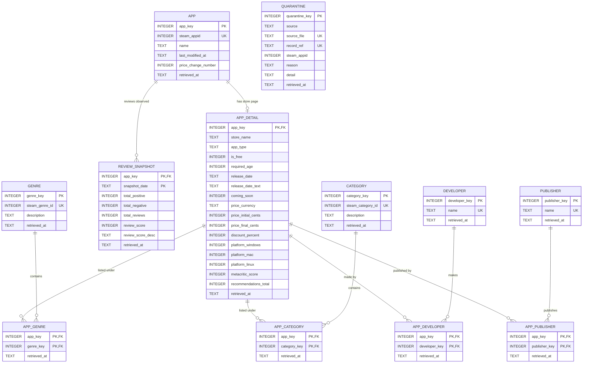

# steam-catalog-trends-pipeline
# Steam Catalog Trends by Release Year

## The question

This project looks at how the Steam game catalogue has changed by release year: how many games were released each year and which genres rose or fell. We also want to predict a game's share of positive reviews from its release year, price, genres and platform support. Repeated snapshots of review counts will show how satisfaction and popularity evolve over time. The findings could help a small developer decide which genre and price point to target.

## Data sources

All three come from Steam (Valve Corporation). Full source cards: [docs/sources.md](docs/sources.md).

- **App list** - every app on Steam (`IStoreService/GetAppList`, API key required)
- **App details** - store page data per app (`store.steampowered.com/api/appdetails`)
- **Review summary** - review counts per app (`store.steampowered.com/appreviews`)

Attribution: data provided by Steam / Valve Corporation. <!-- TODO: add any attribution the Steam terms require -->

Raw data is **not committed** (`data/raw/` is git-ignored) until the terms are confirmed to allow redistribution. Run the script to regenerate it.

## How to run

Requires Python 3.9+.

```bash
git clone <repository-url>
cd <repository-folder>

python -m venv .venv
source .venv/bin/activate        # Windows: .venv\Scripts\activate
pip install -r requirements.txt

cp .env.example .env             # Windows: copy .env.example .env
# open .env and set STEAM_API_KEY (free key: https://steamcommunity.com/dev/apikey)

python src/ingest.py
```

Environment variables (all listed in `.env.example`):

| Variable | Meaning | Default |
|---|---|---|
| `STEAM_API_KEY` | Steam Web API key (**required**) | - |
| `MAX_APPS` | Apps fetched per run, `0` = all (many hours) | 300 |
| `SAMPLE_SEED` | Seed for the random sample | 42 |
| `REQUEST_DELAY_SECONDS` | Pause between apps (rate limit ~200 req / 5 min) | 1.6 |
| `REQUEST_TIMEOUT` | Seconds before a request times out | 30 |
| `MAX_RETRIES` | Retries on 429 / 5xx / network errors | 5 |
| `BACKOFF_BASE_SECONDS`, `BACKOFF_MAX_SECONDS` | Exponential backoff settings | 5, 120 |
| `RAW_DATA_DIR` | Output folder | `data/raw` |

Each run saves new files named `<UTC timestamp>_<appid>.json` under `data/raw/applist/`, `data/raw/appdetails/` and `data/raw/appreviews/`. Earlier files are never overwritten. At the end the script prints a run summary (files saved and problems per source). Exit code is `0` if healthy, `1` if there were failures, `2` for authentication or configuration errors.

## How to build the database (M2)

From a fresh clone, with the landed raw data in `data/raw/` (run `python src/ingest.py` first if that folder is empty):

```bash
python src/load.py      # builds data/steam_catalog.db from data/raw/ - never calls the API
python src/load.py      # run it again: 0 new rows, nothing changes (the load is idempotent)
python src/checks.py    # six checks on a temporary copy of the database; prints PASS/FAIL
```

- Needs Python 3.9+ whose SQLite is 3.37 or newer (STRICT tables). Check with `python -c "import sqlite3; print(sqlite3.sqlite_version)"`. `load.py`, `db.py` and `checks.py` use only the standard library.
- Run every command from the repository root. Optional flags: `--db <file>` and `--raw <folder>`.
- `data/steam_catalog.db` is derived data and is **not committed** (`data/*.db` is in `.gitignore`); anyone with the raw data rebuilds it with the commands above.
- `load.py` exits with `0` and `STATUS: COMPLETE`, or with `1` and `STATUS: FAILED - rolled back` (nothing from that run is written). `checks.py` exits with `0` only if all six checks pass.

Run summary of the first load on the M1 data:

```
files read:          204 raw files (2026-10-03T11:38:10Z .. 2026-10-03T11:42:08Z)
                     applist 4 | appdetails 100 | appreviews 100
apps:                190,242 in database (190,242 new this run)
app_details:         100 in database (+100 this run)
genres:              12 in database (12 new this run)
categories:          49 in database (49 new this run)
developers:          107 in database (107 new this run)
publishers:          101 in database (101 new this run)
app links:           genre 283 (+283) | category 508 (+508) | developer 107 (+107) | publisher 101 (+101)
review_snapshots:    100 in database (+100 this run)
superseded:          0 older retrievals of an already-seen key (latest retrieved_at wins)
values cleaned:      46
                           18  app.name: empty text -> NULL
                           27  app_detail.release_date: not a full date (e.g. 'Coming soon', 'Q4 2026') -> NULL
                            1  app_detail.required_age: text -> integer
quarantined:         0 records this run (0 new), 0 in quarantine table
foreign_key_check:   OK
STATUS: COMPLETE
```

The second run prints the same, with `0 new this run` / `+0` on every line.

## Data model

SQLite database built by `src/load.py` from `sql/schema.sql`. All tables are `STRICT`. Every entity has a surrogate key (`*_key INTEGER PRIMARY KEY`) and keeps the source identifier as `NOT NULL UNIQUE`. Every relationship is a declared foreign key, enforced on every connection (`PRAGMA foreign_keys = ON` in `src/db.py`). Every table has `retrieved_at`: the UTC timestamp of the landed raw file the row came from, taken from its file name. Timestamps are ISO 8601 UTC text (`2026-10-03T11:38:18Z`); dates are `YYYY-MM-DD`.

### ER diagram



(`source_file` + `record_ref` together are unique in `QUARANTINE`.)

### Grain of every table

| Table | One row means |
|---|---|
| `app` | one Steam app in the catalogue (`IStoreService/GetAppList`), latest landed version |
| `app_detail` | the latest retrieved store page of one sampled app (type 1: a newer retrieval overwrites it) |
| `genre` | one Steam store genre (Steam's numeric genre id) |
| `category` | one Steam store category (Steam's numeric category id) |
| `developer` | one developer name |
| `publisher` | one publisher name |
| `app_genre` | one app listed under one genre on its latest store page |
| `app_category` | one app listed under one category on its latest store page |
| `app_developer` | one app credited to one developer on its latest store page |
| `app_publisher` | one app credited to one publisher on its latest store page |
| `review_snapshot` | the review counts of one app on one UTC day (the latest retrieval of that day) |
| `quarantine` | one landed record the loader could not load, with the reason |

### Decisions and findings

**Keys.** Tested on the landed raw files of the 2026-10-03 run before writing the schema:

- `app` - natural key `steam_appid`. 190,242 entries across the 4 app-list pages, **0 duplicated appids**.
- `app_detail` - one store page per app. 100 files, 100 distinct appids, and `data.steam_appid` equals the requested appid in all 100.
- *Does the key always mean the same thing?* The app-list `name` and the store `name` differ for 3 of the 100 apps (e.g. `寻宝猎手Hoard Seeker` vs `Hoard Seeker`): the app list often has the native-language title, the store page (requested with `l=english`) the English one. They are different attributes, so both are kept: `app.name` and `app_detail.store_name`.
- `genre` / `category` - Steam's ids are the natural keys. Each of the 12 genre ids and each of the 49 category ids maps to exactly one description.
- `developer` / `publisher` - Steam gives no id, so the trimmed name is the natural key (107 developers, 101 publishers). No two names differ only by upper/lower case.
- `review_snapshot` - key `(app_key, snapshot_date)`. The M1 run fetched every app once, so there are no duplicates yet. The rule "a later retrieval of the same app on the same day wins, whatever order the files are read in" was tested with extra files in a copy of `data/raw/`.
- *Does every reference resolve?* 100 of 100 store pages and 100 of 100 review responses refer to an appid that is in the app list, so nothing is quarantined.

**Missing values.** What a missing or non-numeric value means in this source, and what the loader does:

- `release_date` - 27 of 100 store pages have no full date: `Coming soon` (11), `To be announced` (9), a year only (`2026` ×3, `2027`), `October 2026`, `November 2026`, `Q4 2026`. All 27 are unreleased games (`coming_soon = 1`): the date is *not announced precisely*, not lost. The loader stores `release_date = NULL`, keeps the original text in `release_date_text` and counts them. Turning partial dates into years is cleaning (M3).
- Price - `price_overview` is missing for 40 apps: 12 free games and 28 unreleased paid games that have no price yet. NULL price means "no price on the store page", **not 0**.
- `app.name` - 18 catalogue entries have an empty name: stored as NULL and counted.
- `required_age` - Steam sends a number, but once the text `"16"`: converted to 16 and counted. Values that cannot be converted would become NULL and be counted.
- `metacritic_score` (1 of 100) and `recommendations_total` (9 of 100) are mostly absent: NULL = not provided by Steam.
- One app has no `publishers` field: it simply has no `app_publisher` row.
- Review counts - 35 apps have 0 reviews; that is a real zero, stored as 0. The positive share is then undefined, so the query uses `NULLIF(…, 0)`.

**Unknown references.** A store page or review response for an appid that is in no landed app list goes to `quarantine` (reason `unknown_app`). It is not dropped and does not crash the load, because it may well be a real app that appeared after the app list was fetched. If a later app list contains the app, the next load loads the record and removes it from quarantine. A store response with `success: false` (no store page) goes to quarantine as `no_store_data`. A raw file that is not valid JSON is treated differently: the landed data is damaged, so the whole load stops and is rolled back (`STATUS: FAILED`). This is what the atomicity check in `src/checks.py` exercises.

**Change over time.** Names, prices, discounts, genres and platforms can change. For M2 these are type 1: the most recently retrieved version wins, decided by `retrieved_at` (and `ON CONFLICT … DO UPDATE … WHERE excluded.retrieved_at >= retrieved_at`, so an older file loaded later can never overwrite newer data). The links of an app (genres, categories, developers, publishers) are re-synced from its winning store page. Review counts are kept as history instead: one `review_snapshot` row per app per day. A studio that renames itself would appear as a new developer, because Steam has no developer id.

**Known issues.**

- Only 100 of the 190,242 catalogue apps have store details and reviews (`MAX_APPS` sample in M1). Results describe that sample; years with 1-3 games are noisy.
- There is a single landing run (2026-10-03), so `review_snapshot` has one day so far.
- `review_score` is 0 for 23 apps that do have reviews. All 23 have fewer than 10 reviews, and Steam writes e.g. `"5 user reviews"` in `review_score_desc` instead of a rating; every app with 10 or more reviews has a score. A score of 0 means "too few reviews", not "worst".
- 3 games have a full release date after the retrieval date (announced dates, `coming_soon = 1`).
- Steam sends genre ids as text (`"23"`) but category ids as numbers; the loader converts both to integers.
- The release-date parser expects English dates (`Oct 17, 2017`), which is what `l=english` returns.
- Developer and publisher names are free text, so one studio could appear under two spellings. None was found in this sample.
- All 100 sampled apps are `type = game`; M1 called `GetAppList` with its default filters, which list games.

### Analytical query

`sql/queries/01_releases_by_year.sql` answers the M0 question "how does the catalogue change by release year?":

```sql
-- Result grain: one row per release year (YYYY), plus one row 'no full date'.
-- app_detail has one row per app, so COUNT(*) per year counts each game once.
-- review_snapshot has one row per app per day: latest_review keeps only each
-- app's most recent snapshot BEFORE the join, so the join cannot multiply games.
-- positive_share_pct = SUM(positive) / SUM(reviews): review-weighted.
WITH latest_review AS (
    SELECT app_key, total_positive, total_reviews,
           ROW_NUMBER() OVER (PARTITION BY app_key ORDER BY snapshot_date DESC) AS rn
    FROM review_snapshot
),
games AS (
    SELECT d.app_key,
           COALESCE(SUBSTR(d.release_date, 1, 4), 'no full date') AS release_year,
           d.coming_soon, d.is_free, d.price_initial_cents,
           r.total_positive, r.total_reviews
    FROM app_detail AS d
    LEFT JOIN latest_review AS r ON r.app_key = d.app_key AND r.rn = 1
    WHERE d.app_type = 'game'
)
SELECT release_year,
       COUNT(*)                                                         AS games,
       SUM(CASE WHEN coming_soon = 1 THEN 1 ELSE 0 END)                 AS not_yet_released,
       SUM(CASE WHEN is_free = 1 THEN 1 ELSE 0 END)                     AS free_games,
       ROUND(AVG(CASE WHEN is_free = 0 THEN price_initial_cents END) / 100.0, 2)
                                                                        AS avg_list_price_usd,
       SUM(CASE WHEN total_reviews > 0 THEN 1 ELSE 0 END)               AS games_with_reviews,
       SUM(total_reviews)                                               AS reviews,
       ROUND(100.0 * SUM(total_positive) / NULLIF(SUM(total_reviews), 0), 1)
                                                                        AS positive_share_pct
FROM games
GROUP BY release_year
ORDER BY release_year;
```

Output:

| release_year | games | not_yet_released | free_games | avg_list_price_usd | games_with_reviews | reviews | positive_share_pct |
|---|---|---|---|---|---|---|---|
| 2013 | 1 | 0 | 0 | 5.99 | 1 | 463 | 83.6 |
| 2015 | 1 | 0 | 0 | 0.99 | 1 | 11158 | 93.1 |
| 2016 | 3 | 0 | 1 | 1.49 | 3 | 727 | 55.3 |
| 2017 | 4 | 0 | 0 | 18.49 | 4 | 19791 | 74.4 |
| 2018 | 7 | 0 | 1 | 2.57 | 7 | 137 | 66.4 |
| 2019 | 3 | 0 | 2 | 0.99 | 3 | 404 | 91.1 |
| 2020 | 5 | 0 | 0 | 9.39 | 5 | 662 | 82.2 |
| 2021 | 6 | 0 | 0 | 6.32 | 6 | 575 | 72.9 |
| 2022 | 9 | 0 | 1 | 8.49 | 8 | 151 | 77.5 |
| 2023 | 1 | 0 | 0 | 4.99 | 1 | 102 | 52.0 |
| 2024 | 10 | 0 | 3 | 7.42 | 10 | 1545 | 70.6 |
| 2025 | 7 | 0 | 2 | 2.79 | 6 | 450 | 76.4 |
| 2026 | 16 | 3 | 0 | 10.14 | 10 | 5930 | 89.1 |
| no full date | 27 | 27 | 2 | NULL | 0 | 0 | NULL |

`sql/queries/02_genre_share_by_year.sql` adds the genre view (one row per release year and genre; a game with several genres is counted in each, and the share divides by the games of that year counted before the genre join).

## Repository structure

```
.
├── README.md
├── .gitignore              # also ignores the database file (data/*.db)
├── .env.example            # variable names with placeholder values
├── requirements.txt
├── sql/
│   ├── schema.sql          # M2: every table, STRICT, safe to run more than once
│   └── queries/            # M2: analytical queries (grain stated at the top)
├── src/
│   ├── ingest.py           # M1: lands raw API responses in data/raw/
│   ├── db.py               # M2: connect() (foreign keys ON) and shared helpers
│   ├── load.py             # M2: raw files -> database (idempotent, atomic, parameterised)
│   └── checks.py           # M2: six checks against a temporary copy of the database
├── data/
│   ├── raw/                # landed responses, exactly as received
│   └── steam_catalog.db    # built by src/load.py (not committed)
└── docs/
    └── sources.md          # data source cards
```

## Status

M2 — schema and load complete

## Team

| Name | GitHub |
|---|---|
| Yasin Gündoğan | @yasingundogan |
| Muhammet Mustafa Sarıbuğa | @se-220717006 |
| Emre Kahraman | @EmreKa-0 |
