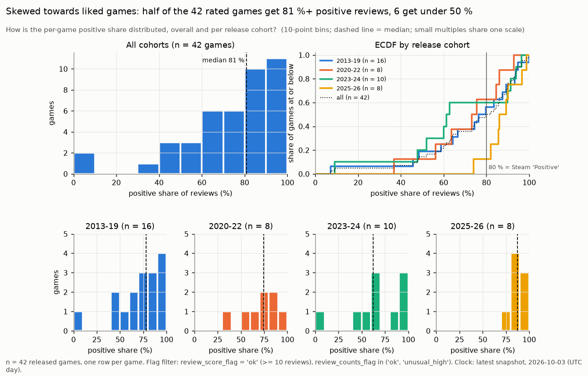
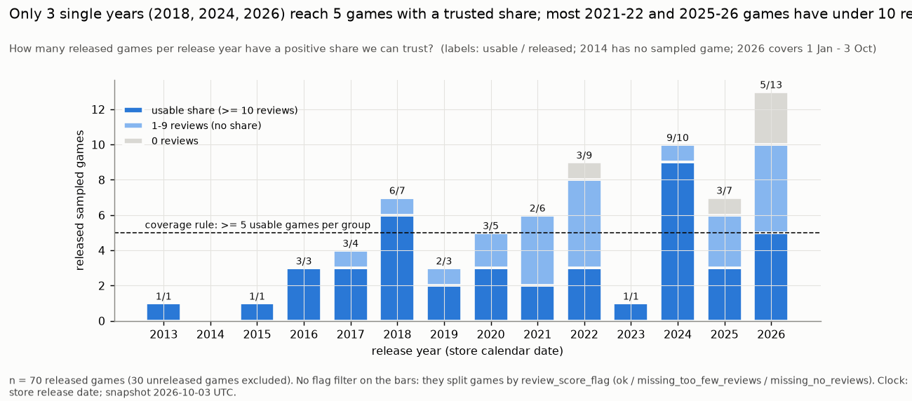
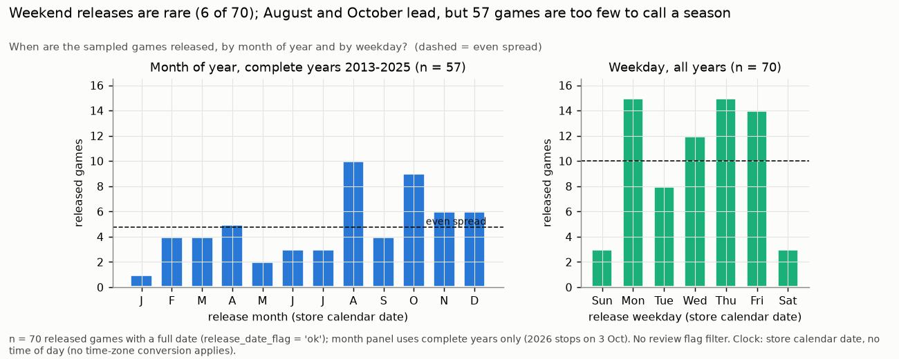
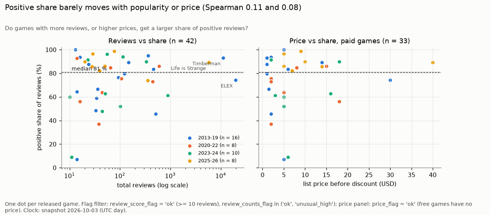
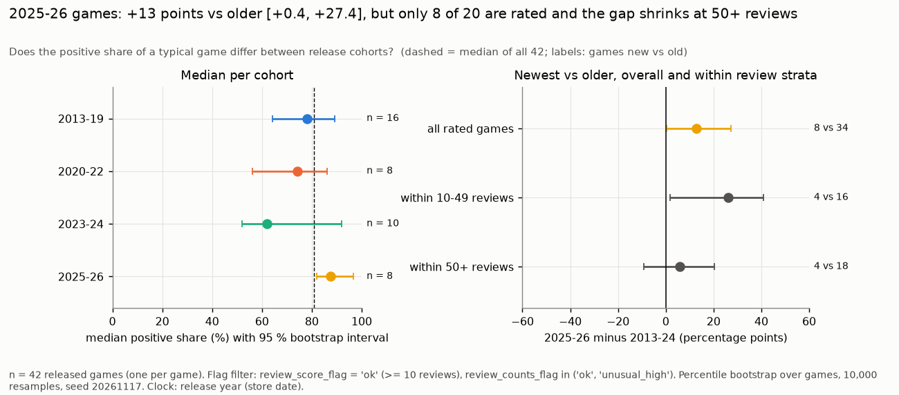

# Exploratory Analysis — Steam Catalog Trends by Release Year

Milestone M4 · Lifecycle stage: EXPLORE · Data: one landing run, 2026-10-03 (100 sampled games, 70 released)
Notebook: [`notebooks/m4_eda.ipynb`](../notebooks/m4_eda.ipynb) · Helpers: [`src/explore.py`](../src/explore.py) ·
Queries: [`sql/queries/03`–`07`](../sql/queries/) · Figures: [`figures/`](../figures/)

Every number below is printed by the notebook, run top to bottom on a fresh build (`load.py`, `clean.py`). Unless a
line says otherwise, the **flag filter** is `review_score_flag = 'ok'` (at least 10 reviews, so Steam shows a score)
and `review_counts_flag IN ('ok', 'unusual_high')` (the three very popular games are kept), and the unit is **one
released game**.

## 1. Summary

We asked how the share of positive reviews of a typical game differs between release-year cohorts. Across the 42
released games with a trusted share, the median game gets **80.9 %** positive reviews; the distribution is skewed
towards liked games, with a tail of 6 games under 50 %. The newest cohort (2025-26) has the highest median, 87.6 %
against 74.9 % for 2013-2024 (+12.7 points, 95 % bootstrap interval +0.4 to +27.4). We are **not** confident this
is a real difference: only 8 of the 20 released 2025-26 games have 10 reviews yet, so the rated ones are a selected
group, the gap falls to +6 points (interval −9 to +20) among games with 50+ reviews, and it was the largest of
about 14 comparisons we looked at. Popularity and price show almost no relationship with the share (Spearman 0.11
and 0.08). What would change the answer most is more data: a larger sample per year and a second snapshot, so
that recent games have time to collect reviews.

**M3 issues fixed since the `m3` tag.** M4 makes "any value formatted into SQL anywhere in the repository" a
pass/fail check. Two cells of `notebooks/m3_profile.ipynb` built SQL by concatenating table and column names (no
values, but a scan cannot tell); both now use static query strings (`db.COUNT_SQL` and a two-entry dict). The
notebook was re-executed; its outputs are unchanged apart from library versions. No cleaning rule changed.

## 2. Raw versus cleaned

The key number: *the median positive share of a released game.* Queries:
[`03_key_number_raw.sql`](../sql/queries/03_key_number_raw.sql) on the M2 tables as loaded, and
[`04_key_number_clean.sql`](../sql/queries/04_key_number_clean.sql) on the cleaned layer. Both take the latest
snapshot per game and `coming_soon = 0`; the raw query has no flag to filter on.

```sql
-- raw (M2): share = positive / reviews, review_score averaged as stored
SELECT 100.0 * l.total_positive / NULLIF(l.total_reviews, 0) AS share_pct, l.review_score
FROM app_detail AS d JOIN latest AS l ON l.app_key = d.app_key AND l.rn = 1
WHERE d.app_type = 'game' AND d.coming_soon = 0
-- cleaned: the same, from game_clean_v, plus the flag filter (bound as JSON arrays)
  AND review_score_flag  IN (SELECT value FROM json_each(:score_flags))   -- ["ok"]
  AND review_counts_flag IN (SELECT value FROM json_each(:count_flags))   -- ["ok", "unusual_high"]
```

| Layer | Released games | Games with a share | Median share | Mean share | Mean Steam score (1-9) |
|---|---|---|---|---|---|
| raw (M2) | 70 | 65 | **75.5 %** | 70.2 % | 3.8 |
| cleaned, flag `ok` | 70 | 42 | **80.9 %** | 73.8 % | 6.3 |

The raw median includes 23 games with 1-9 reviews, whose "share" is a coin of a few reviews (0 %, 100 %, 33 %);
they pull the median down by 5.4 points. The Steam score shows the M3 sentinel directly: 28 released games store
`review_score = 0` meaning "fewer than 10 reviews", and averaging those zeros as scores cuts the mean from 6.3 to
3.8 - the same mistake as averaging −999 as PM10. The five games with 0 reviews drop out of both shares silently
(0 / 0 is NULL in SQLite), which is why the raw query already has 65, not 70.

## 3. The question and its summary

**Question.** How does the share of positive reviews of a typical game differ between release-year cohorts?

**Summary: the median per-game positive share.** The question is about a typical *game* - what a developer
releasing one can expect - so each game counts once. A review-weighted share would let ELEX (19,627 reviews) decide
its cohort alone, and the share is skewed and capped at 100 % (section 4), so the median is less moved by the few
disliked games than the mean. Single years hold 1-16 games, so the groups are four **release cohorts**.

| Cohort | n games | Median | Q1-Q3 | Mean | Review-weighted | Games ≥ 80 % | Reviews |
|---|---|---|---|---|---|---|---|
| 2013-19 | 16 | 78.0 | 62.9-90.2 | 72.7 | 80.7 | 43.8 % | 32,673 |
| 2020-22 | 8 | 74.3 | 61.8-85.0 | 71.1 | 78.4 | 37.5 % | 1,328 |
| 2023-24 | 10 | 62.0 | 54.0-90.9 | 66.4 | 69.7 | 40.0 % | 1,639 |
| 2025-26 | 8 | 87.6 | 84.8-91.6 | 87.8 | 88.4 | 87.5 % | 6,347 |
| all | 42 | 80.9 | 61.6-90.0 | 73.8 | 81.4 | 50.0 % | 41,987 |

**Alternatives and ranking.** The median, the mean and the review-weighted share rank the cohorts the same way
(2025-26 > 2013-19 > 2020-22 > 2023-24). The share of games at or above 80 % (Steam's *Positive* label - the
question "how often does a game get a good label?") swaps the middle two: 2023-24 has more games above 80 % (40 %
against 37.5 %) although its typical game is lower, because it has four games at 89-97 % and a cluster at 47-63 %
(figure 1). The top and bottom of the ranking do not depend on the summary; the middle does, and it rests on 8 and
10 games.

## 4. What the data is made of

### Shape



We tried bins of 5, 10 and 20 percentage points. At 5, most bins hold 0-2 of 42 games; at 20, the 60-79 %
(*Mixed*/*Mostly Positive*) games merge with the 80 %+ (*Positive*) ones. We use 10 points, close to Steam's own
band widths. The shape is **left-skewed** (skewness −1.32): half of the games are at 81 % or above, the mass sits
at 80-100 %, and a thin tail runs down to two games below 10 % (Landlord Simulator 7 %, Sugar Mommy 9 %). The ECDF
(no bins to hide a mode) shows the same and separates the cohorts: 2025-26 rises late and steeply (7 of 8 games
between 82 % and 99 %), 2023-24 rises early. For the summary this means the mean is pulled 7 points below the
median by the tail, and a cohort's mean depends on whether it happens to contain one of the two disliked games -
which supports the median.

### Coverage

The denominator for each group is its released sampled games; a game counts only with a trusted share.

| Release year | 2013 | 2015 | 2016 | 2017 | 2018 | 2019 | 2020 | 2021 | 2022 | 2023 | 2024 | 2025 | 2026 |
|---|---|---|---|---|---|---|---|---|---|---|---|---|---|
| Released games | 1 | 1 | 3 | 4 | 7 | 3 | 5 | 6 | 9 | 1 | 10 | 7 | 13 |
| Trusted share (≥ 10 reviews) | 1 | 1 | 3 | 3 | 6 | 2 | 3 | 2 | 3 | 1 | 9 | 3 | 5 |
| Coverage | 100 % | 100 % | 100 % | 75 % | 86 % | 67 % | 60 % | 33 % | 33 % | 100 % | 90 % | 43 % | 38 % |

By cohort: 2013-19 16 of 19 (84 %), 2020-22 8 of 20 (40 %), 2023-24 10 of 11 (91 %), 2025-26 8 of 20 (40 %). 2014
has no sampled game; 9 games dated 2026 and 1 dated 2027 are unreleased, and 20 unreleased games have no year.
The thin entities are every single year except 2018, 2024 and 2026, and the 2020-22 and 2025-26 cohorts, where
60 % of the games are missing from the share.



**Coverage rules.**

| Aggregate | Rule | Why |
|---|---|---|
| A game's positive share | at least 10 reviews (`review_score_flag = 'ok'`) | with 1-9 reviews the share moves in steps of 10-100 points; Steam itself shows no score below 10 |
| A group median (year or cohort) | at least 5 games with a trusted share | below 5 the median is one or two games; same threshold as `validate.py` |
| A month-of-year count | complete calendar years only (2013-2025) | 2026 stops on 3 October, so it would add January-September only |

**With and without the group rule**, median share per single release year:

| Year | 2013 | 2015 | 2016 | 2017 | 2018 | 2019 | 2020 | 2021 | 2022 | 2023 | 2024 | 2025 | 2026 |
|---|---|---|---|---|---|---|---|---|---|---|---|---|---|
| n | 1 | 1 | 3 | 3 | 6 | 2 | 3 | 2 | 3 | 1 | 9 | 3 | 5 |
| without rule | 83.6 | 93.1 | 76.3 | 74.3 | 77.1 | 76.8 | 56.2 | 74.3 | 84.6 | 52.0 | 62.7 | 86.0 | 89.2 |
| with rule | — | — | — | — | 77.1 | — | — | — | — | — | 62.7 | — | 89.2 |

Without the rule the "trend" swings from 93 % (2015, one game: Timberman) to 52 % (2023, one game) and looks like a
story; with it, three years remain and no year-by-year trend can be read. This is why the groups are cohorts.

### Flag filter

Cohort medians under three filters (n / median):

| Filter | 2013-19 | 2020-22 | 2023-24 | 2025-26 |
|---|---|---|---|---|
| **reported:** score `ok`, counts `ok` + `unusual_high` | 16 / 78.0 | 8 / 74.3 | 10 / 62.0 | 8 / 87.6 |
| score `ok`, counts `ok` only (drop ELEX, Timberman, Life is Strange) | 14 / 78.0 | 8 / 74.3 | 10 / 62.0 | 7 / 86.0 |
| score `ok` or `missing_too_few_reviews` (1+ review) | 19 / 79.7 | 19 / 66.7 | 11 / 61.3 | 16 / 87.6 |

Dropping the three popular games changes almost nothing for the median (it would move a review-weighted share a lot).
Admitting games with 1-9 reviews more than doubles 2020-22 and 2025-26 and moves the 2020-22 median by 7.6 points,
because those games' shares are a handful of reviews each. We report the first filter: the second throws away real
measurements of three well-reviewed games, the third mixes measurements with noise.

## 5. Time

**Clock.** `release_date` is the calendar date shown on the US English store page. It has no time of day and no time
zone, so there is nothing to convert with `tz_convert`; years, months and weekdays are taken from that date as
given. `snapshot_date` and `retrieved_at` are UTC. Game age at the snapshot = UTC snapshot day minus store date;
a possible one-day offset does not matter at the 90-day scale we use. There is **one snapshot** (2026-10-03), so
the time dimension is release time, not change over time - review growth cannot be seen until M5 adds snapshots.

**Edges.** The first full date is 2013-10-14 (2013 has one game; 2014 has none). The last released date is
2026-09-23, and 2026 is cut at the retrieval day: it covers 1 January - 3 October, and its games had at most nine
months to collect reviews. We handled this in two ways: month-of-year counts use complete years only (57 games), and
cohort results always state coverage, because the age of a game decides whether it has 10 reviews:

| Age at snapshot | Released | Trusted share | Coverage |
|---|---|---|---|
| < 90 days | 6 | 2 | 33 % |
| 90-364 days | 10 | 3 | 30 % |
| 1-3 years | 14 | 12 | 86 % |
| > 3 years | 40 | 25 | 62 % |

**Two scales.** Release *year* is shown in figure 2 (coverage) and section 4; *month of year* and *weekday* in
figure 3.



| Month (2013-2025) | J | F | M | A | M | J | J | A | S | O | N | D |
|---|---|---|---|---|---|---|---|---|---|---|---|---|
| Games | 1 | 4 | 4 | 5 | 2 | 3 | 3 | 10 | 4 | 9 | 6 | 6 |

| Weekday (all years) | Sun | Mon | Tue | Wed | Thu | Fri | Sat |
|---|---|---|---|---|---|---|---|
| Games | 3 | 15 | 8 | 12 | 15 | 14 | 3 |

Weekend releases are rare: 6 of 70, against 20 if days were equal. August (10) and October (9) lead the months,
but 57 games over 12 months is roughly 5 per month and three of the August games are from late August 2020 alone;
we do not call it a season.

**Calendar.** Five releases fall between 20 December and 2 January (the Christmas holidays and Steam's Winter Sale
window): 2017-12-31, 2018-12-31, 2024-12-20, 2025-12-25, 2025-12-29. Two are 31 December, a date that a developer
might use as a placeholder for "end of the year"; with 2 of 70 games they do not move any year count, and we kept
them (section 8, back to cleaning). The two 2025 holiday releases have 1 and 4 reviews, so holiday timing feeds the
coverage problem rather than the share. We did not check other known dates (Steam Next Fest, seasonal sales): with
70 dated games, no calendar week holds more than 2 releases.

## 6. Relationships



**Question.** Do more popular games (more reviews) or more expensive games get a larger positive share? Plotted
first (figure 4): both clouds are flat, with the two disliked games at the bottom left of the review panel.

| Relationship (flag filter as reported; rows state removals) | n | Pearson | Spearman |
|---|---|---|---|
| log10 reviews vs share: all | 42 | 0.22 | 0.11 |
| without the 3 `unusual_high` games | 39 | 0.18 | 0.06 |
| without the 2 games below 20 % | 40 | 0.09 | −0.02 |
| price vs share: all paid (`price_flag = 'ok'`) | 33 | 0.15 | 0.08 |
| price: without `unusual_high` | 30 | 0.15 | 0.13 |
| price: under 20 USD (drop ELEX, Life is Strange) | 31 | 0.12 | 0.05 |
| log10 reviews within 2013-19 / 2020-22 / 2023-24 / 2025-26 | 16 / 8 / 10 / 8 | 0.23 / 0.27 / 0.36 / −0.19 | 0.06 / 0.21 / 0.38 / −0.14 |

**Which coefficient describes the picture.** Spearman: the shares are skewed and bounded, and Pearson's 0.22 is
made by two games - Landlord Simulator and Sugar Mommy have 11-14 reviews and shares under 10 %; removing them
(5 % of the games) cuts Pearson to 0.09. **Shared pattern.** Within cohorts the sign is not stable (−0.19 to 0.38
on 8-10 games each), so a cohort effect is not making the pooled correlation; there is simply none to speak of.
Price is the same: no monotone relation, and the two most expensive games (30 and 40 USD) sit at 74 % and 89 %.

## 7. The comparison

**Comparison.** Median positive share of the newest cohort (released 2025-26) against all older rated games
(2013-24). It is the M0 question - has the catalogue changed by release year? - in its simplest form.

**Unit and interval.** The unit is the game: there is one snapshot, so each game is already one row and no
repeated measurements need aggregating. Percentile bootstrap of the difference in medians, resampling games
within each group, 10,000 resamples, seed 20261117.

| Group | n | Median share |
|---|---|---|
| 2025-26 | 8 | 87.6 % |
| 2013-24 | 34 | 74.9 % |
| **Difference** | | **+12.7 points, 95 % interval [+0.4, +27.4]** |



**Composition check.** The two groups are not the same mixture:

| | 2025-26 | 2013-24 |
|---|---|---|
| Rated games / released games | 8 / 20 (40 %) | 34 / 50 (68 %) |
| Median reviews | 44.5 | 53 |
| With 50+ reviews | 50 % | 53 % |
| Indie | 62.5 % | 79.4 % |
| Free | 12.5 % | 23.5 % |
| Median list price | 9.0 USD | 5.0 USD |
| Median age at snapshot | 225 days | 2,240 days |

A 2025-26 game is in the rated group only if it collected 10 reviews within months; older games had years. So
the new group is the more successful 40 %, while the old group keeps games that crept past 10 reviews slowly.
Within subgroups:

| Stratum | n new / old | Median new | Median old | Difference [95 %] |
|---|---|---|---|---|
| all | 8 / 34 | 87.6 | 74.9 | +12.7 [+0.4, +27.4] |
| 10-49 reviews | 4 / 16 | 87.9 | 61.8 | +26.0 [+1.7, +40.8] |
| 50+ reviews | 4 / 18 | 87.6 | 81.6 | +6.0 [−9.3, +20.2] |
| Indie | 5 / 27 | 86.0 | 83.6 | +2.4 [−10.7, +23.3] |
| not Indie | 3 / 7 | 89.2 | 60.0 | +29.2 [+12.6, +48.1] |

The direction does not reverse (no Simpson's paradox), but the gap shrinks to +6 points with an interval across
zero among games with 50+ reviews and to +2 points among Indie games; it lives in small games and in the 3 + 7
non-Indie games. With 3-5 games per cell these strata are themselves fragile.

**Looks.** Before choosing it we looked at about 14 comparisons (about 32 numbers): the 6 pairs of cohorts,
Indie vs not Indie (+16.9 [−4.6, +30.5]), free vs paid (−5.7 [−30.4, +20.8]), the three rule-passing single years,
two relationships with two coefficients each, the cohort medians under three flag filters, and the four strata
above. The reported comparison is the M0 question, but it is also the largest cohort contrast. An interval whose
lower end is +0.4 points, picked out of ~14 looks, is a **hypothesis**, not a finding.

## 8. Findings

| ID | Finding | Evidence | Label | What would change it | Explored by |
|---|---|---|---|---|---|
| F-01 | Cleaning raises the median positive share of released games from 75.5 % (65 games) to 80.9 % (42), and the mean Steam score from 3.8 to 6.3, because 28 sentinel zeros and 23 games with 1-9 reviews leave the summary | §2; queries 03, 04 | Confirmed (arithmetic) | — (a change to `MIN_REVIEWS_FOR_SCORE`) | Muhammet Mustafa Sarıbuğa |
| F-02 | The per-game share is left-skewed (skewness −1.32): half of the games reach 81 %, 6 of 42 are below 50 %, so the median is the summary for a typical game | fig1; §4 | Exploratory | a larger sample with more mid-range games; per-genre shapes | Muhammet Mustafa Sarıbuğa |
| F-03 | Only 42 of 70 released games have a trusted share; coverage is 40 % in 2020-22 and 2025-26 against 84-91 % in the other cohorts, and only 2018, 2024 and 2026 reach 5 rated games as single years | fig2; query 06 | Confirmed (counted) | more sampled games per year (`MAX_APPS`); a later snapshot | Yasin Gündoğan |
| F-04 | Median, mean and review-weighted share rank the cohorts the same (2025-26 first, 2023-24 last); the share of games ≥ 80 % swaps 2020-22 and 2023-24 | §3 table | Exploratory | one or two games moving across 80 % in the 8-10-game cohorts | Muhammet Mustafa Sarıbuğa |
| F-05 | Rated 2025-26 games have a higher median share than older ones (+12.7 points, [+0.4, +27.4]), but the group is the 40 % that reached 10 reviews and the gap shrinks to +6 [−9, +20] at 50+ reviews | fig5; §7 | Exploratory (hypothesis; 1 of ~14 looks) | the 12 unrated 2025-26 games reaching 10 reviews in later snapshots; a larger sample | Emre Kahraman |
| F-06 | Neither popularity (Spearman 0.11) nor list price (0.08) is related to the share; Pearson's 0.22 for reviews is made by two disliked games and falls to 0.09 without them | fig4; §6 table | Exploratory | many more games with 100+ reviews; within-genre comparison | Emre Kahraman |
| F-07 | Weekend releases are rare (6 of 70 against 20 for equal days); no month stands out beyond small-sample noise | fig3; query 07 | Exploratory | the store's date for regional releases; a sample of a few hundred dated games | Yasin Gündoğan |
| F-08 | Admitting games with 1-9 reviews moves the 2020-22 median from 74.3 % to 66.7 % and doubles its n, while dropping the three `unusual_high` games moves no median by more than 1.6 points | §4 flag table | Confirmed (arithmetic) | — (a different flag filter is a different question) | Yasin Gündoğan |
| F-09 | Indie games have a higher median share than non-Indie ones (+16.9 points), with an interval across zero [−4.6, +30.5] on 10 non-Indie games | §7 looks | Exploratory (hypothesis) | more non-Indie games; controlling for release cohort | Emre Kahraman |

### Back to cleaning

- **Nothing in the cleaned layer was wrong.** Every value used here passed the M3 rules, and the notebook found no
  new sentinel, impossible value or identity problem; `clean.py` is unchanged.
- **Added to the M3 issues register as I-18 (kept, no rule):** two released games dated 31 December (2017, 2018)
  might carry a placeholder "end of year" date. There is no evidence either way in the data, and a wrong day does not
  change a release year, so we keep them and record the check
  ([cleaning_report.md](cleaning_report.md), section 3).
- **SQL in the M3 notebook** built from string concatenation was replaced with static queries (section 1).

### Forward to modelling

- **The outcome exists only for 42 games, chosen by success.** A model of positive share trained on rated games
  learns about games that reached 10 reviews; it says nothing about the 28 released games that did not, and recent
  games are rated only if they did well early (F-03, F-05). M7 should model "reaches 10 reviews" as its own question
  or weight for it.
- **Leakage.** `review_score`, `review_score_desc` and `recommendations_total` are computed from the same reviews
  as the outcome; `total_reviews` decides whether the outcome exists. None of them may be a predictor.
- **Age confounds release year.** At one snapshot, a 2026 game is both "new" and "young"; M7 needs snapshots from
  M5 so that games can be compared at the same age (e.g. share after 180 days).
- **Thin groups.** 8-16 games per cohort, 3-10 per genre beyond the big four. Genres and platforms as predictors
  need more sampled apps; until then use cohorts, not years, and report intervals.
- **Price is a list price on one day.** Use `price_initial_cents`; discounts are a one-day picture (M3 §8).
- **Questions for M7:** does release year predict the share once age is held equal? Does genre (Indie, Casual,
  Action) predict it within a cohort? What predicts reaching 10 reviews at all?

## 9. What we can't say

- **Anything about the Steam catalogue as a whole.** The sample is 100 of 190,242 apps (70 released, 42 rated).
  Every result describes this sample, with intervals 25-40 points wide.
- **That newer games are better liked.** F-05 is the largest of ~14 looks, its lower bound is +0.4 points, and the
  newest games are a selected 40 %. It is a hypothesis for the next snapshots, not a trend.
- **Anything about single release years.** Ten of 13 years have fewer than 5 rated games.
- **How reviews change over time.** There is one snapshot; we see where games are on 2026-10-03, not how they got
  there or where the 12 unrated 2025-26 games will end up.
- **The share for games with fewer than 10 reviews.** It is not low or high but unknown (M3 I-06), and probably
  different from rated games.
- **Effects.** Nothing here is causal; the comparisons are descriptive and the relationships are near zero.
